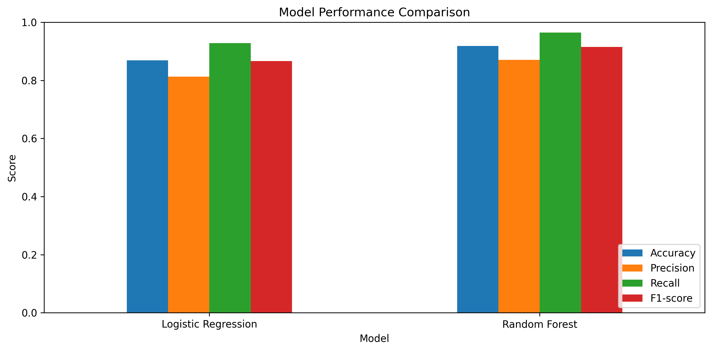

# Heart Disease Risk Classification

A machine learning project that explores and compares Logistic Regression and Random Forest models for binary heart disease classification using the UCI Heart Disease dataset.

## Project Overview

The goal of this project is to explore the dataset, preprocess the features, train two classification models, and compare their performance using standard evaluation metrics.

## Dataset

- **Source:** [UCI Machine Learning Repository — Heart Disease](https://archive.ics.uci.edu/dataset/45/heart+disease)
- **Dataset size:** 303 records
- **Input features:** 13
- **Target:** Binary classification
  - `0`: No disease indicated
  - `1`: Disease indicated

The original target values were converted into a binary target, where values greater than zero indicate disease presence in the dataset.

## Technologies Used

- Python
- Pandas and NumPy
- Matplotlib
- Scikit-learn
- `ucimlrepo`
- Jupyter Notebook

## Methodology

1. Loaded the dataset.
2. Explored data types, missing values, duplicate records, and target distribution.
3. Performed exploratory data analysis.
4. Handled missing feature values using median imputation.
5. Split the dataset into training and testing sets using an 80:20 stratified split.
6. Trained Logistic Regression and Random Forest classifiers.
7. Compared the models using accuracy, precision, recall, F1-score, and confusion matrices.

## Results

| Metric | Logistic Regression | Random Forest |
|---|---:|---:|
| Accuracy | 86.9% | 91.8% |
| Precision | 81.2% | 87.1% |
| Recall | 92.9% | 96.4% |
| F1-score | 86.7% | 91.5% |

### Model Performance Comparison

Random Forest performed better across the reported metrics on this particular test split.



## Project Structure

```text
Heart-Disease-Risk-Classification/
├── Heart_Disease_Risk_Classification.ipynb
└── README.md
```

## How to Run

1. Clone or download this repository.
2. Install the required libraries:

   ```bash
   pip install pandas numpy matplotlib scikit-learn ucimlrepo jupyter
   ```

3. Open the notebook in Jupyter Notebook or VS Code.
4. Run the notebook cells from top to bottom.

The dataset is fetched through `ucimlrepo`, so an internet connection may be required when loading it.

## Limitations and Disclaimer

This project is for educational purposes only. The dataset is relatively small, and the reported metrics come from a single train-test split. The models have not been clinically validated and must not be used for medical diagnosis or treatment decisions.

## Future Improvements

- Evaluate performance using cross-validation.
- Tune model hyperparameters.
- Explore ROC-AUC and additional evaluation metrics.
- Test on larger, independent datasets.
- Investigate feature importance and model interpretability.

## Contributors

- Monisha M
- Tanya

## Acknowledgements

Thanks to the UCI Machine Learning Repository for providing the Heart Disease dataset.
